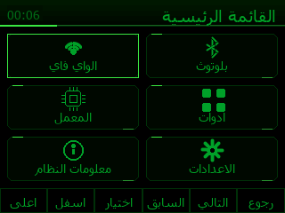
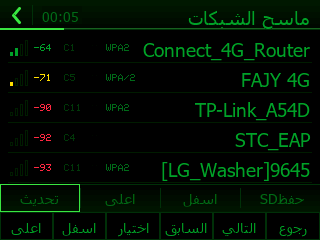
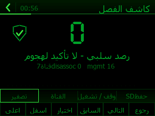
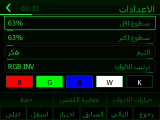
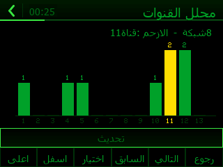
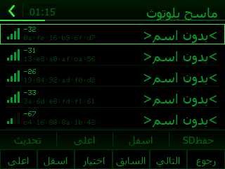
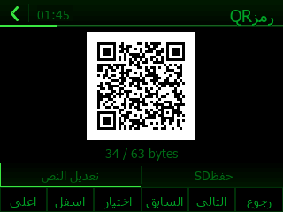

<div dir="rtl">

# 🛡️ CYBERCORE

**أداة أمن شبكات محمولة — فيرموير عربي مستقل للوحة ESP32 بشاشة لمس**

> واجهة عربية كاملة · لمس · **27 أداة رئيسية + 26 أداة متقدمة** · دفاعية بالكامل

[](https://github.com/Youssef840/cybercore/actions/workflows/build.yml)


[](LICENSE)

<p align="center">
  
</p>

---

## نظرة عامة

**CYBERCORE** يحوّل لوحة **ESP32-2432S028R** («Cheap Yellow Display») إلى أداة جيب لفحص وتشخيص
وأمن الشبكات اللاسلكية، بواجهة عربية كاملة (محرّك تشكيل وربط حروف واتجاه يمين-لليسار مكتوب خصيصاً).

> ⚠️ **كل المميزات دفاعية / سلبية فقط:** مسح، رصد، تدقيق، تشخيص. **لا يوجد أي هجوم** —
> لا فصل هجومي، لا إغراق، ولا بوابات وهمية. استعمله على شبكاتك وأجهزتك فقط.

## لقطات من الجهاز

| ماسح الشبكات | تدقيق/كاشف الفصل | الإعدادات |
|:---:|:---:|:---:|
|  |  |  |
| محلل القنوات | ماسح بلوتوث | رمز QR |
|  |  |  |

## المميزات

- **الواي فاي (13 أداة):** ماسح الشبكات · تدقيق الحماية · محلل القنوات · كاشف الفصل (deauth) ·
  كاشف التوأم (Evil-Twin) · محلل الحركة · اتصال + أدوات شبكة (ping / فحص أجهزة / فحص بورتات) ·
  شبكات مخفية · تدقيق PMF/WPS · فحص خدمات · تشخيص DNS · مراقب التغيّر · رؤوس HTTP.
- **بلوتوث (4 أدوات):** ماسح BLE · رادار بلوتوث · مراقب جهاز · تحليل إعلان.
- **المعمل:** ماسح I2C · مقياس جهد (ADC) · كشّاف.
- **أدوات:** المختبر المتقدم (26 أداة: DNS / حساب شبكات / تحويلات / بصمات SHA256) ·
  رمز QR · مؤقّت · لعبة · مدير ملفات SD · ساعة ومنبّه.
- **عام:** ثيمات ألوان · معايرة لمس · حفظ النتائج على بطاقة SD.

## التشغيل السريع

### ⚡ من المتصفح (بدون تثبيت أي برنامج)

افتح **[youssef840.github.io/cybercore](https://youssef840.github.io/cybercore/)** من Chrome أو Edge على الكمبيوتر،
وصّل اللوحة بـ USB واضغط «تثبيت على اللوحة». الفيرموير في الصفحة يُبنى تلقائياً من آخر نسخة في `main`.

### من الكود (PlatformIO)

```bash
pip install platformio
cd CYBERCORE
platformio run -e cyd2usb -t upload --upload-port COM4   # المنفذ حسب جهازك
```

> على ويندوز ضع المشروع في **مسار قصير** (مثل `C:\dev\CYBERCORE`).

## 📖 الدليل الكامل

شرح الواجهة وكل أداة مع **مثال كيف تستفيد منها** (PDF عربي منسّق):
**[CYBERCORE/docs/CYBERCORE_Guide_AR.pdf](CYBERCORE/docs/CYBERCORE_Guide_AR.pdf)**

## العتاد

لوحة **CYD-2USB** = ESP32-2432S028R · شاشة ILI9341 لمس 320×240 · فتحة microSD · منفذ I2C/ADC.
جدول التوصيلات كامل في الدليل.

## ⚠️ تنبيه قانوني

الاستقبال والرصد مسموح في معظم الدول، لكن اعتراض أو فك اتصالات الآخرين قد يكون مخالفاً.
استعمل الأداة على أجهزتك وشبكاتك فقط. لا يحتوي الفيرموير أي مسار هجومي.

## الرخصة

[MIT](LICENSE) © 2026 Youssef Hussein

</div>
